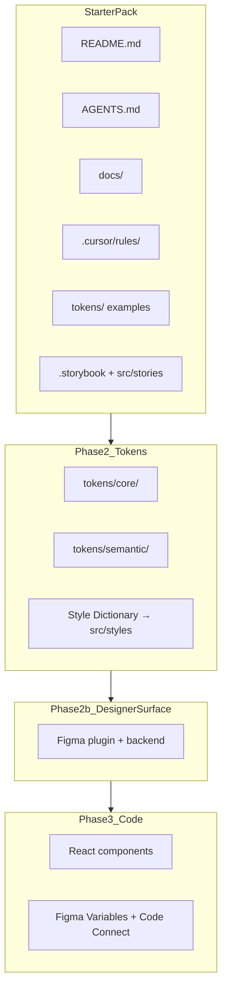

# Agentic Design System — Starter Plan

> **Maintainer-only** — Local roadmap for developing this starter pack. Not part of the published design-system docs. See `.cursor/AGENTS.dev.md`.
>
> Living roadmap for this repository. Edit this file as the starter evolves.

## What this repo is (and is not)

This is an **agentic design system starter pack** — a small, cloneable template for teams who want structure, agent rules, and worked examples before building a full system.

| In scope (starter) | Out of scope (you extend later) |
|--------------------|----------------------------------|
| Doc structure, templates, agent read order | Complete component library |
| **Example** foundation tokens (color, spacing, type, motion) | Every semantic combination or theme mode |
| One worked pattern (empty state) | Full pattern catalog |
| Governance and decisions backlog | Production Figma library or CI pipeline |
| Storybook + Style Dictionary CSS | Full multi-platform token pipelines |

**Design goal:** Enough content to show *how* to organize and extend — not so much that newcomers feel overwhelmed. Prefer one clear example over exhaustive coverage.

### Simplicity rule (for humans and agents)

This starter must stay **easy to read and easy to change**. Prefer the smallest solution that works for the default workflow (`npm run storybook` / `npm run tokens:build`).

**Before adding code, ask:**

1. Does a simpler option exist (relative path, fewer imports, no new package)?
2. Does this force a new dependency, `@types/*`, custom plugin, or cache workaround?
3. Would a beginner understand it without a paragraph of explanation?

If the answer to (2) is yes, **stop and choose the simpler option** unless there is a concrete bug you cannot fix otherwise.

**"Agentic"** means the repo is structured so Cursor (and similar agents) can:

- Find authoritative answers without guessing
- Follow consistent naming, layering, and contribution rules
- Extend the system incrementally (tokens → components → Figma sync) using the same doc patterns



---

## Current status (2026-11-25)

| Phase | Status | What exists |
|-------|--------|-------------|
| **Starter — Docs + agents** | Complete | `docs/` tree, agent rules, templates, governance |
| **Phase 2 — Example tokens** | In progress | DTCG JSON under `tokens/`; Style Dictionary → `src/styles/tokens.css` |
| **Phase 2b — Figma designer surface** | Planned | Evaluated; not scaffolded — see below |
| **Phase 3 — Code** | In progress | Storybook + React/Vite; Astro `site/` **removed** |

---

## Repository structure

```
agentic-design-system/
├── README.md
├── AGENTS.md
├── CONTRIBUTING.md
├── LICENSE
├── docs/                         # Vision, guidelines, governance, component/pattern specs
├── tokens/                       # DTCG JSON — core/, semantic/, composite/, theme/
├── src/                          # Stories + generated CSS
├── .storybook/                   # Storybook config
├── style-dictionary.config.js
└── .cursor/                      # Local maintainer notes (gitignored)
    ├── PLAN.md
    ├── AGENTS.dev.md
    └── rules/
```

**README policy:** Only two README files — root `README.md` (project) and `docs/README.md` (all documentation).

**Separation rule:** Foundation **guides** live in `docs/`. Token **values** live in `tokens/`. Do not mix JSON token files into foundation markdown.

---

## Phase 2 — Example tokens (framework-agnostic)

**Status:** In progress

### Decisions made

1. **Format:** [DTCG](https://design-tokens.github.io/community-group/format/) JSON with `$schema`, `$value`, `$type`, and `$description`.
2. **Layers:** Core → Semantic → Composite; optional Theme modes.
3. **CSS:** Style Dictionary at repo root (`npm run tokens:build`) writes `src/styles/tokens.css` and `tokens.dark.css`.

### Remaining work (optional)

1. Expand theme modes when needed.
2. Multi-platform outputs (iOS / Android) only when a consumer asks.
3. Optional CI checks for hardcoded values.

---

## Phase 2b — Figma designer surface (planned)

**Status:** Planned

Designers should use the design system **inside Figma** without cloning the repo. Git remains the source of truth. **Defer until starter tokens stabilize.**

---

## Phase 3 — Code and design sync

**Status:** Storybook scaffold; Astro docs site removed (2026-11-25)

When ready — **not required for the starter pack**:

1. Grow Storybook stories and React components.
2. Keep specs in `docs/components/`.
3. Figma Variables aligned with DTCG names; optional Code Connect.
4. CI for doc links, a11y, optional visual regression.

Do **not** reintroduce an Astro `site/` package unless product explicitly chooses a separate docs site again.

---

## Success criteria

### Starter pack (target)

- [x] Folder structure and stub docs
- [x] Agent rules and AGENTS.md onboarding
- [x] Example pattern / templates
- [x] Decisions backlog for unresolved issues
- [x] Token folder structure (`core/`, `semantic/`, `theme/`)
- [x] Example tokens for color, spacing, typography, motion
- [x] Style Dictionary CSS for Storybook
- [ ] Your team replaces example values with brand-specific content

### Phase 3 (early)

- [x] Storybook + Vite/React
- [x] Tokens emit CSS variables for Storybook
- [x] Astro `site/` removed
- [ ] Broader component implementation

---

## Risks and mitigations

| Risk | Mitigation |
|------|------------|
| Users expect a complete DS | State clearly in README and PLAN: **starter pack**, not full system |
| Too many files for beginners | Single hub at `docs/README.md`; minimal token examples |
| Docs become stale templates | Ship real examples in vision, one pattern, and token samples |
| Token guides mixed with JSON | Guides in `docs/`; values in `tokens/` |
| Tooling grows too complex | **Simplicity rule** — prefer stock Vite/Storybook/SD; avoid deps “just in case” |

---

## Changelog (plan)

| Date | Change |
|------|--------|
| 2026-07-31 | Initial v1 docs-first structure implemented |
| 2026-08-06 | Phase 2 example tokens; starter-pack scope clarified |
| 2026-08-06 | Phase 3: Astro docs site (later removed) |
| 2026-11-25 | Removed Astro `site/`; Storybook + Style Dictionary are the preview/CSS path |
