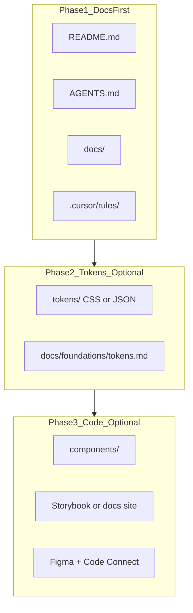

# Agentic Design System — Starter Plan

## Goal

Turn [agentic-design-system](https://github.com/jcmartinezma/bravo-design-system) into a **free, public starting point** for teams building design systems with AI agents. Version 1 is **docs-first**: no component library, no build tooling — only structured markdown context and agent guidance that humans and agents can read, extend, and clone.

**"Agentic"** here means the repo is intentionally structured so Cursor (and similar agents) can:

- Find authoritative answers without guessing
- Follow consistent naming, layering, and contribution rules
- Extend the system incrementally (tokens → components → Figma sync) using the same doc patterns




---

## Current State

The repo is a greenfield scaffold:


| Exists                              | Missing                             |
| ----------------------------------- | ----------------------------------- |
| [README.md](README.md) (title only) | Folder structure, docs, agent rules |
| [LICENSE](LICENSE) (GPL-3.0)        | `.gitignore`, contribution guide    |


No constraints from existing code — we can define structure from scratch.

---

## Options Explored (and chosen path)

### 1. Scope options


| Option                                | Pros                                                   | Cons                             | Decision            |
| ------------------------------------- | ------------------------------------------------------ | -------------------------------- | ------------------- |
| **Docs-only**                         | Fast to ship; works for any stack; ideal agent context | No live component reference      | **Chosen for v1**   |
| Docs + tokens                         | Single source of truth for visual values               | Needs build/export tooling       | Document as Phase 2 |
| Full starter (components + Storybook) | Production-ready clone                                 | High maintenance; forces a stack | Document as Phase 3 |


### 2. Code stack options (for later phases)


| Option                                                           | Best for                                         | Notes                                                                                                   |
| ---------------------------------------------------------------- | ------------------------------------------------ | ------------------------------------------------------------------------------------------------------- |
| **Framework-agnostic tokens** (CSS variables / Style Dictionary) | Teams on React, Vue, Swift, etc.                 | **Preferred direction** when code is added                                                              |
| React + Tailwind + shadcn-style                                  | Web apps, fast agent codegen                     | Good reference: [eFounders/design-system-template](https://github.com/eFounders/design-system-template) |
| Web Components                                                   | Cross-framework, design-system-starter-kit style | Heavier setup                                                                                           |


### 3. Documentation hosting options (future)


| Option                       | When to use                                          |
| ---------------------------- | ---------------------------------------------------- |
| Markdown in repo (v1)        | Zero infra; agents read files directly               |
| Storybook                    | Foundations + components (current)                   |
| Figma as design source       | When visual library is added; pair with Code Connect |


### 4. Agent integration options


| Mechanism                        | Purpose                                                        |
| -------------------------------- | -------------------------------------------------------------- |
| [AGENTS.md](AGENTS.md)           | Root-level agent onboarding (repo map, priorities, do/don't)   |
| [.cursor/rules/](.cursor/rules/) | Scoped rules (e.g. docs tone, token naming, pattern authoring) |
| `docs/` markdown                 | Long-form context agents cite during implementation            |
| Optional `.cursor/skills/` later | Reusable workflows (e.g. "add a new pattern doc")              |


Inspired by AI-native templates that treat **markdown + agent rules as first-class artifacts** (e.g. eFounders' `CLAUDE.md` / `DESIGN.md` split).

---

## Proposed Repository Structure (v1)

```
agentic-design-system/
├── README.md                    # Vision, quick start, repo map
├── AGENTS.md                    # Agent onboarding & conventions
├── CONTRIBUTING.md              # How humans/agents extend the system
├── LICENSE                      # (existing GPL-3.0)
├── .gitignore
├── docs/
│   ├── PLAN.md                  # This plan — living document, editable
│   ├── README.md                # Single docs hub — all navigation and section overviews
│   ├── vision/
│   │   ├── design-principles.md
│   │   ├── agentic-workflow.md  # How agents should use this repo
│   │   ├── voice-and-tone.md
│   │   └── writing-guidelines.md
│   ├── foundations/
│   │   ├── color.md             # Placeholder guidelines (no token files yet)
│   │   ├── typography.md
│   │   ├── spacing.md
│   │   ├── motion.md
│   │   └── accessibility.md
│   ├── components/
│   │   └── _template.md         # Copy to author new component specs
│   ├── patterns/
│   │   ├── _template.md
│   │   └── example-empty-state.md  # One minimal example pattern
│   └── governance/
│       ├── contribution-model.md
│       ├── versioning.md
│       ├── quality-bar.md
│       └── decisions-backlog.md  # Pending maintenance tasks and issues found
├── .cursor/
│   └── rules/
│       ├── design-system-core.mdc      # alwaysApply: principles & layering
│       ├── docs-authoring.mdc          # globs: docs/**/*.md
│       └── patterns-and-components.mdc # globs: docs/components/**, docs/patterns/**
```

**Design choice:** Separate `vision/`, `foundations/`, `components/`, `patterns/`, and `governance/` folders mirror industry-standard DS doc layers and keep agent retrieval predictable. Voice, tone, and writing guidelines live under `vision/` alongside principles — they define *how* the system communicates, not visual foundations.

**README policy:** Only two README files — root [README.md](README.md) (project) and [docs/README.md](docs/README.md) (all documentation). No README per section; section overviews, file lists, and navigation live in `docs/README.md` for humans.

---

## Markdown Structure (what each section contains)

### Root files

| File | Purpose |
|------|---------|
| **README.md** | Project vision, who it's for, quick start, and a map of the repo |
| **AGENTS.md** | Onboarding for AI agents: read order, conventions, do/don't, links to key docs |
| **CONTRIBUTING.md** | How humans and agents propose changes, review expectations, and extend the system |
| **LICENSE** | GPL-3.0 (existing) |

### `docs/` — documentation hub

| File | Purpose |
|------|---------|
| **PLAN.md** | Living roadmap — editable copy of this plan; tracks Phase 2+ decisions |
| **README.md** | **Single entry point for all documentation** — section overviews, links to every doc file, recommended read order, component vs pattern taxonomy, and how to add new docs. Written for humans; agents use [AGENTS.md](AGENTS.md) for machine-oriented onboarding |

**`docs/README.md` should include:**

- Brief description of each layer (vision, foundations, components, patterns, governance)
- Linked file list per folder
- Component vs pattern guidance (when to create each type of doc)
- Suggested reading path for new contributors
- Note to update this file when adding or renaming docs

### `docs/vision/` — why and how the system thinks

Defines the *intent* behind every design decision. Agents should read this before generating UI or writing copy.

| File | Purpose |
|------|---------|
| **design-principles.md** | 5–7 core principles (e.g. token-first, accessible by default, progressive disclosure) with do/don't examples |
| **agentic-workflow.md** | How agents should use this repo; read order: governance → principles → voice/writing → foundations → patterns → components; log unresolved issues to `decisions-backlog.md` |
| **voice-and-tone.md** | Brand personality, tone per context (success, error, empty state), capitalization rules |
| **writing-guidelines.md** | UI copy patterns: labels, errors, confirmations, empty states — critical for agents writing interface text |

### `docs/foundations/` — visual building blocks (guidelines only in v1)

Guideline docs **without** token files in v1. Each file should cover:

- What the category is (for beginners)
- Naming conventions to use when tokens are added later
- Accessibility expectations for that category
- A "When you add tokens" note pointing to Phase 2

| File | Purpose |
|------|---------|
| **color.md** | Color roles (primary, surface, semantic), contrast expectations, light/dark guidance |
| **typography.md** | Type scale, font families, weights, line heights, responsive type rules |
| **spacing.md** | Spacing scale, layout rhythm, padding/margin conventions |
| **motion.md** | Duration, easing, and when to animate (and when not to) |
| **accessibility.md** | WCAG baseline, focus, contrast, keyboard, and screen reader expectations |

### `docs/components/` — individual UI building blocks

Specs for single, reusable UI elements (Button, Input, Dialog, etc.).

| File | Purpose |
|------|---------|
| **_template.md** | Copy to author new specs: purpose, anatomy, variants, states, accessibility, content, related patterns, open questions |

### `docs/patterns/` — multi-component compositions

Reusable solutions that combine components to solve a user problem (empty states, forms, navigation, etc.).

| File | Purpose |
|------|---------|
| **_template.md** | Copy to author new patterns: problem, solution, composition, layout, responsive behavior, content rules |
| **example-empty-state.md** | One filled example so contributors see expected depth and structure |

### `docs/governance/` — how the system evolves

| File | Purpose |
|------|---------|
| **contribution-model.md** | Who can contribute, review flow, roles (maintainers vs contributors) |
| **versioning.md** | How doc and (future) token/component changes are versioned |
| **quality-bar.md** | Definition of done for new docs, patterns, and components; review checklist |
| **decisions-backlog.md** | Running log of pending maintenance tasks, open questions, and issues found during work; agents prompt users to add entries here when gaps or inconsistencies are discovered |

**`decisions-backlog.md` workflow:** When an agent finds a missing guideline, conflicting doc, accessibility gap, or deferred decision, it should ask the user to record it in this file rather than silently working around it. Each entry should include: date, category (e.g. foundation, component, pattern), description, severity, and suggested owner/action.

### `.cursor/rules/` — agent behavior rules

| File | Purpose |
|------|---------|
| **design-system-core.mdc** | Always-on: layering rules, token naming, no hardcoded values |
| **docs-authoring.mdc** | Applies to `docs/**/*.md`: heading structure, plain language, cross-linking |
| **patterns-and-components.mdc** | Applies to component/pattern docs: when to use each type, mandatory accessibility block |

---

## Agent Rules (`.cursor/rules/`)

Three focused rules (not one giant file):

1. **design-system-core.mdc** (`alwaysApply: true`)
  - Layering: foundations → components → patterns (dependencies flow down)
  - Never hardcode values in examples; reference token *names* even before tokens exist
  - Prefer extending existing docs over duplicating
  - When a gap, inconsistency, or unresolved decision is found, ask the user to add an entry to `docs/governance/decisions-backlog.md`
2. **docs-authoring.mdc** (`globs: docs/**/*.md`)
  - Heading structure, required sections per doc type
  - Plain language; explain terms for beginners
  - Link related docs; update `docs/README.md` when adding or renaming files
3. **patterns-and-components.mdc** (`globs: docs/components/**, docs/patterns/`**)
  - When to use pattern vs component doc
  - Mandatory accessibility block
  - Use `_template.md` as base

Root **[AGENTS.md](AGENTS.md)** summarizes: repo map, read order, file naming, "start here" links, and the rule to route unresolved issues to [decisions-backlog.md](docs/governance/decisions-backlog.md) — agents load this first.

---

## Root README Upgrade

Expand [README.md](README.md) to include:

- One-paragraph vision ("agent-friendly DS starter")
- Who it's for (designers, engineers, DS leads, agent users)
- Quick start: clone → read root `README.md` → open [docs/README.md](docs/README.md) for the doc map → copy a `_template.md` from `docs/components/` or `docs/patterns/` → fill foundations for your brand
- Link to [docs/PLAN.md](docs/PLAN.md) as the roadmap
- License note (GPL-3.0)
- Badge placeholders (license, "docs-first")

---

## Phase 2 & 3 (documented, not built in v1)

Capture in `docs/PLAN.md` so the starter stays honest about what's next:

**Phase 2 — Framework-agnostic tokens**

- Add `tokens/` with CSS custom properties and/or Style Dictionary JSON
- Wire `docs/foundations/*.md` to real token names
- Optional `scripts/ds-check` to block hardcoded values (reference: eFounders gate pattern)

**Phase 3 — Code & design sync**

- Component implementation in consumer-chosen framework
- Storybook or static doc site
- Figma variables library + Code Connect mappings
- CI: accessibility and docs link checks

---

## Implementation Steps (after plan approval)

1. Add `.gitignore` (OS, editor, future `node_modules/`)
2. Create folder tree and stub markdown files with front-matter-style metadata (title, status: draft, owner: community)
3. Write [docs/PLAN.md](docs/PLAN.md) — full copy of this plan for ongoing edits
4. Author core content: `design-principles.md`, `voice-and-tone.md`, `writing-guidelines.md`, `decisions-backlog.md`, `AGENTS.md`, comprehensive `docs/README.md`, component/pattern templates
5. Add `.cursor/rules/*.mdc` files aligned with doc structure
6. Expand root `README.md` and add `CONTRIBUTING.md`
7. Optional: add one GitHub issue template ("Propose a pattern" / "Propose a foundation update")

**Out of scope for v1:** npm package, Storybook, Figma file, token build pipeline, component code.

---

## Success Criteria

- A new team can clone the repo and **immediately** have a clear place to write principles, foundations, patterns, and governance
- An agent opening the repo can follow `AGENTS.md` → rules → `docs/README.md` without inventing structure
- [docs/PLAN.md](docs/PLAN.md) exists as the editable roadmap for Phase 2+
- All docs cross-link; `docs/README.md` is the single human-facing navigation hub
- Public-ready: readable README, contribution guide, consistent tone for beginners

---

## Risks & Mitigations


| Risk                                          | Mitigation                                                               |
| --------------------------------------------- | ------------------------------------------------------------------------ |
| Docs become stale templates with no substance | Ship 1 complete example pattern + solid principles doc                   |
| GPL-3.0 limits commercial adoption            | Call out in README; consider relicensing later if needed                 |
| Too many files overwhelm beginners            | Strong `docs/README.md` nav + "start with vision/design-principles" path |
| Agents ignore docs                            | `alwaysApply` core rule + explicit read order in AGENTS.md               |
| Issues found during work are lost or ignored  | Agents must prompt users to log entries in `decisions-backlog.md`          |


---

## Key Files to Create First

Priority order when implementing:

1. [docs/PLAN.md](docs/PLAN.md)
2. [AGENTS.md](AGENTS.md)
3. [docs/README.md](docs/README.md)
4. [docs/vision/design-principles.md](docs/vision/design-principles.md)
5. [docs/vision/voice-and-tone.md](docs/vision/voice-and-tone.md)
6. [docs/governance/decisions-backlog.md](docs/governance/decisions-backlog.md)
7. [docs/components/_template.md](docs/components/_template.md)
8. [docs/patterns/_template.md](docs/patterns/_template.md)
9. [.cursor/rules/design-system-core.mdc](.cursor/rules/design-system-core.mdc)
