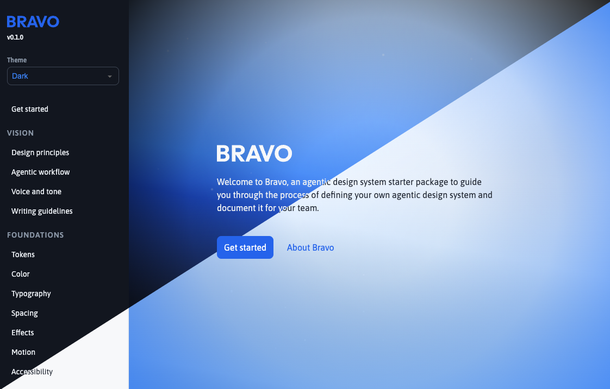

# Bravo Design System
**v0.2.0**

[](LICENSE)
[](docs/README.md)

A **free, public starter pack** for teams building design systems with AI agents.

You get structure, agent rules, sample tokens, and Storybook so you can extend with your brand without wading through exhaustive content.



## Quick start

1. **Clone** this repository (or use it as a GitHub template).
2. Replace example values in **[tokens/](tokens/)** with your brand.
3. Customize **[docs/vision/](docs/vision/)** with your brand principles, voice, and writing rules.
4. Copy **[docs/components/_template/](docs/components/_template/)** to add new components or ask your agent to generate new ones.
5. AI agents: start at **[AGENTS.md](AGENTS.md)**.
6. Optional — run Storybook locally to browse foundations and components.

### Storybook

```sh
npm install
npm run storybook
```

Rebuild CSS from tokens when you change JSON under `tokens/`:

```sh
npm run tokens:build
```

## Who this is for

- **Design system leads** setting up a new system from scratch.
- **Designers and engineers** who want clear doc + token structure before full implementation.
- **Teams using Cursor or other AI agents** who need machine-readable conventions and human-readable context in one repo.

## What you get

- DTCG Tokens, Vision and Patterns docs
- Templates for components and patterns
- Agent rules and Skills
- Governance rules
- Storybook for foundations and component previews

## What "agentic" means

The repo is structured so agents can:

- Find authoritative answers without guessing.
- Generate tokens and components in Figma via MCP connections.
- Write and update files to fill gaps.
- Log unresolved issues to [decisions-backlog.md](docs/governance/decisions-backlog.md) instead of inventing conflicting rules.


## Repository map

| Path | Purpose |
|------|---------|
| [AGENTS.md](AGENTS.md) | Agent onboarding and read order (design system usage) |
| [CONTRIBUTING.md](CONTRIBUTING.md) | How to contribute |
| [docs/vision/](docs/vision/) | Principles, voice, tone, agent workflow |
| [docs/foundations/](docs/foundations/) | Foundation guidelines (markdown) |
| [tokens/](tokens/) | Example token values (DTCG JSON) |
| [docs/components/](docs/components/) | Component specs (includes [button example](docs/components/button/spec.md)) |
| [docs/patterns/](docs/patterns/) | Pattern specs (includes [empty state example](docs/patterns/example-empty-state.md)) |
| [docs/governance/](docs/governance/) | Contribution model, versioning (for *your* system), quality bar, [decisions backlog](docs/governance/decisions-backlog.md) |
| [.cursor/rules/](.cursor/rules/) | Cursor agent rules for extending the design system |
| [.cursor/skills/](.cursor/skills/) | Cursor agent skills |
| [.storybook/](.storybook/) | Storybook config |
| [src/](src/) | Stories and generated token CSS |

## Future enhancements
- Improved collaboration and contribution workflow via Figma plugin.
- Support for React components.
- More basic components.

## License

This project is licensed under the [GNU General Public License v3.0](LICENSE). Derivative works must remain open under GPL. If you need a permissive license for a commercial fork, relicense your fork explicitly.

## Contributing

See [CONTRIBUTING.md](CONTRIBUTING.md). Improvements to the starter template are welcome.
